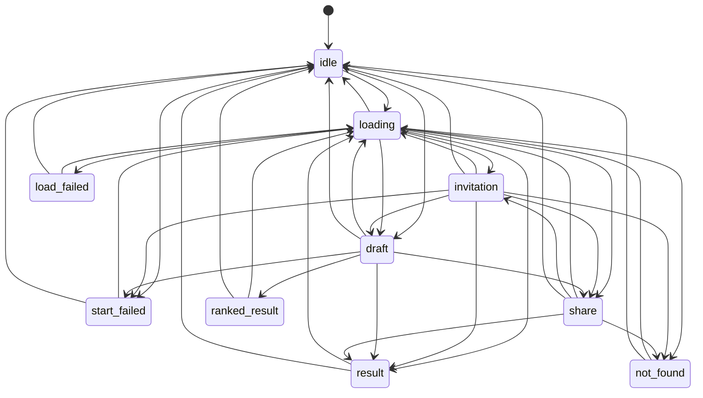
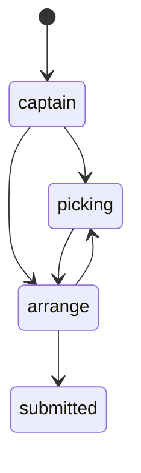
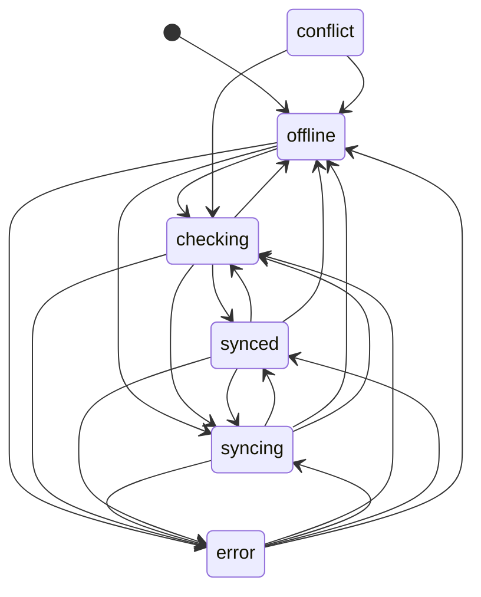
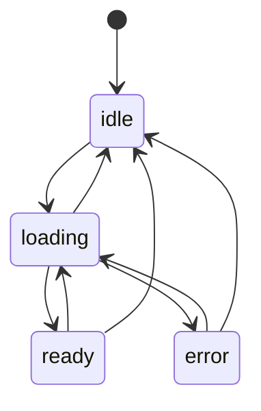
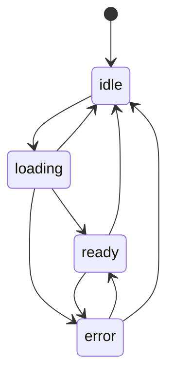
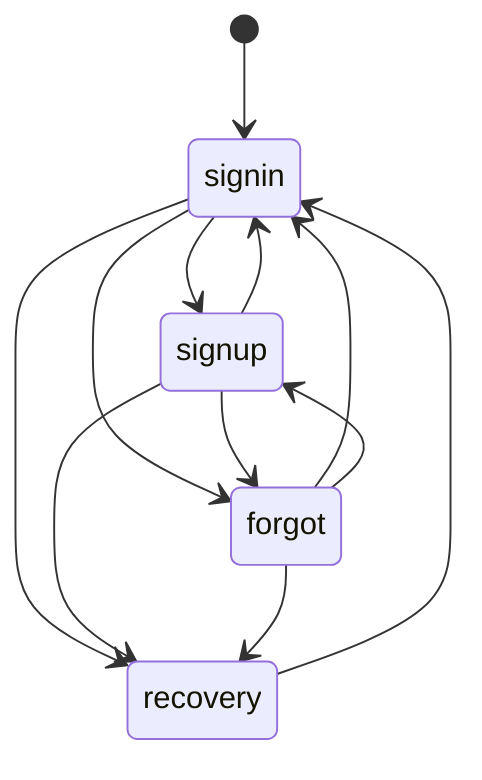
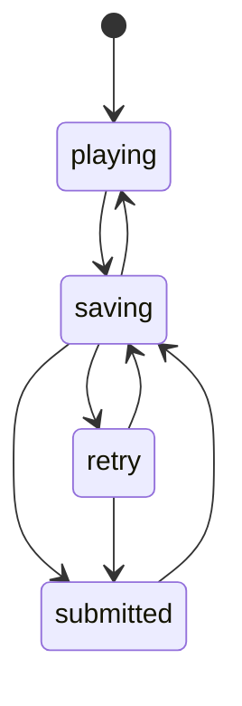
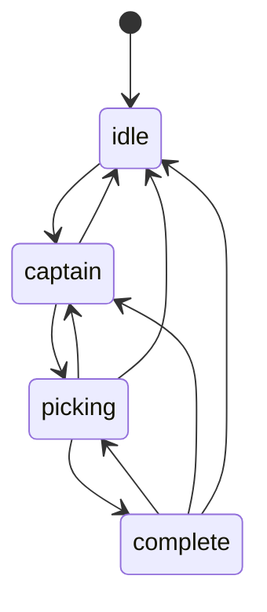
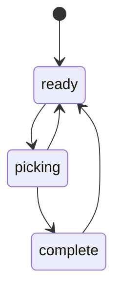
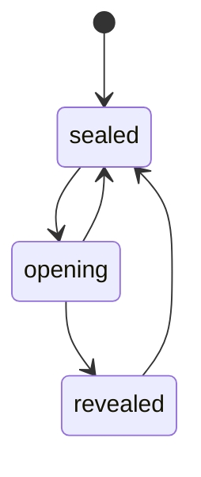

# State machines

<!-- Generated from state-machines.js by `npm run build:state-docs`. Do not edit by hand. -->

Every state machine in the game client is declared in `state-machines.js`. This page is generated from it.

## Working with them

- **Change a state:** in `backend.js` call `move(machine, holder, field, to)`. Never assign the field directly; `tests/state-machines.test.mjs` fails if you do.
- **Add a state or a move:** declare it in `state-machines.js`, handle it where the page is drawn, then run `npm run build:state-docs`.
- **Undeclared moves never block the player.** The value is still written. The move is logged once and kept in `ATUStateMachines.violations`. The backend tests fail on any such entry.
- **Inspect a running game:** `ATUStateMachines.snapshot()` in the browser console returns the current state of every machine. The current page is also on `#app` as `data-screen`.
- **Stored** machines keep their state in one field. **Derived** machines are read from several fields with the helper named in the table; the code that owns those fields makes the moves.

| Machine | Kind | Lives in | Field | States |
| --- | --- | --- | --- | --- |
| [screen](#screen) | stored | `index.html` | `screen` | 15 |
| [duel](#duel) | stored | `backend.js` | `state.challenge.phase` | 10 |
| [duelRun](#duelrun) | stored | `backend.js` | `state.challenge.active.stage` | 4 |
| [cloudSave](#cloudsave) | stored | `backend.js` | `state.cloudStatus` | 6 |
| [rankings](#rankings) | stored | `backend.js` | `state.rankings.status` | 4 |
| [friends](#friends) | stored | `backend.js` | `state.friends.status` | 4 |
| [authForm](#authform) | stored | `backend.js` | `state.authMode` | 4 |
| [gameRun](#gamerun) | stored | `backend.js` | `atu-game-runs-v1 runs.draft.status` | 4 |
| [draft](#draft) | derived | `index.html` | `draftPhase(D)` | 4 |
| [daily](#daily) | derived | `index.html` | `dailyPhase(DD)` | 3 |
| [raftersPack](#rafterspack) | derived | `index.html` | `raftersPhase(RF)` | 3 |

## screen

Which page of the game is showing. Any page can open any other; an unknown page name opens Home.

Starts in `landing`.

| State | Meaning | Can move to |
| --- | --- | --- |
| `landing` | Home | any state |
| `draft` | Classic Draft | any state |
| `classic` | Pack Mode | any state |
| `daily` | Daily Challenge | any state |
| `team` | Deep Team | any state |
| `rare` | Rare Pull | any state |
| `challenge` | 1v1 Draft Duel | any state |
| `rankings` | 82-0 Club | any state |
| `collection` | Collection | any state |
| `rafters` | The Rafters | any state |
| `trophies` | Trophy Case | any state |
| `friends` | Friends | any state |
| `account` | Account & Save | any state |
| `updates` | Info | any state |
| `share` | Shared squad (opened from a ?share= link) | any state |

## duel

The 1v1 Draft Duel page, from opening a link to the final result. Reset returns to idle from anywhere.

Starts in `idle`.

| State | Meaning | Can move to |
| --- | --- | --- |
| `idle` | Start a duel | `loading`, `draft`, `start_failed` |
| `loading` | Opening the challenge | `invitation`, `draft`, `share`, `result`, `not_found`, `load_failed`, `idle` |
| `invitation` | Viewing an invitation | `loading`, `draft`, `share`, `result`, `not_found`, `start_failed`, `idle` |
| `draft` | Drafting | `share`, `result`, `ranked_result`, `loading`, `start_failed`, `idle` |
| `share` | Locked in, waiting for the friend | `loading`, `result`, `invitation`, `not_found`, `idle` |
| `result` | Final result | `loading`, `idle` |
| `ranked_result` | Ranked run saved | `loading`, `idle` |
| `not_found` | Link does not match a duel | `loading`, `idle` |
| `load_failed` | Duel could not be loaded | `loading`, `idle` |
| `start_failed` | Duel could not be started or accepted | `loading`, `idle` |

## duelRun

One player's duel draft, saved on the device under atu-active-challenge-v1.

Starts in `captain`.

| State | Meaning | Can move to |
| --- | --- | --- |
| `captain` | Choosing a captain | `picking`, `arrange` |
| `picking` | Drafting the other seven | `arrange` |
| `arrange` | Setting the lineup | `picking`, `submitted` |
| `submitted` | Locked in | nothing (final) |

## cloudSave

Online save status shown on the Account page.

Starts in `offline`.

| State | Meaning | Can move to |
| --- | --- | --- |
| `offline` | Saved on this device | `checking`, `syncing`, `error` |
| `checking` | Checking your save | `synced`, `syncing`, `error`, `offline` |
| `syncing` | Saving your game | `synced`, `error`, `offline`, `checking` |
| `synced` | Safe & synced | `syncing`, `checking`, `error`, `offline` |
| `error` | Save paused | `checking`, `syncing`, `synced`, `offline` |
| `conflict` | Loading online save (declared and labelled, but no code enters it today) | `checking`, `offline` |

## rankings

Leaderboard loading. Idle means the next visit to the page reloads it.

Starts in `idle`.

| State | Meaning | Can move to |
| --- | --- | --- |
| `idle` | Not loaded | `loading` |
| `loading` | Loading | `ready`, `error`, `idle` |
| `ready` | Showing the leaderboard | `loading`, `idle` |
| `error` | Could not load | `loading`, `idle` |

## friends

Friends list loading. A refresh keeps the last list on screen, so ready and error reload in place.

Starts in `idle`.

| State | Meaning | Can move to |
| --- | --- | --- |
| `idle` | Not loaded | `loading` |
| `loading` | First load | `ready`, `error`, `idle` |
| `ready` | Showing friends | `error`, `idle` |
| `error` | Could not check friends | `ready`, `idle` |

## authForm

Which form the signed-out Account page shows.

Starts in `signin`.

| State | Meaning | Can move to |
| --- | --- | --- |
| `signin` | Sign in | `signup`, `forgot`, `recovery` |
| `signup` | Create account | `signin`, `forgot`, `recovery` |
| `forgot` | Send reset email | `signin`, `signup`, `recovery` |
| `recovery` | Choose a new password | `signin` |

## gameRun

An online Classic Draft run. Only a perfect 82-0 season is saved, and a better lineup can be saved again.

Starts in `playing`.

| State | Meaning | Can move to |
| --- | --- | --- |
| `playing` | Drafting or rearranging | `saving` |
| `saving` | Saving the result | `submitted`, `retry`, `playing` |
| `retry` | Result not saved yet | `saving`, `submitted` |
| `submitted` | Saved to the 82-0 Club | `saving` |

## draft

A Classic Draft board. Derived from D.stage and D.done; the draft engine owns the moves.

Starts in `idle`.

| State | Meaning | Can move to |
| --- | --- | --- |
| `idle` | No draft started | `captain` |
| `captain` | Choosing a captain | `picking`, `idle` |
| `picking` | Filling the board | `complete`, `captain`, `idle` |
| `complete` | All eight picked, lineup can be rearranged | `picking`, `captain`, `idle` |

## daily

Today's Daily Challenge board. Derived from DD and DD.done; opening the page starts it.

Starts in `ready`.

| State | Meaning | Can move to |
| --- | --- | --- |
| `ready` | Not opened today | `picking` |
| `picking` | Filling the board | `complete`, `ready` |
| `complete` | Final board, lineup can be rearranged | `ready` |

## raftersPack

The Rafters zipper pack. Derived from RF.open, RF.done and RF.pull.

Starts in `sealed`.

| State | Meaning | Can move to |
| --- | --- | --- |
| `sealed` | Pack closed | `opening` |
| `opening` | Zipper being pulled | `revealed`, `sealed` |
| `revealed` | Cosmetic revealed | `sealed` |

## In-flight latches

These booleans only stop a second copy of one request from starting. Each is set before the request and cleared when it settles, so they are not modelled as machines.

| Latch | Lives in | Guards |
| --- | --- | --- |
| `state.busy` | `backend.js` | Account and duel buttons while a request runs |
| `state.refreshingChallenge` | `backend.js` | One duel refresh at a time |
| `state.friends.busy`, `state.friends.loading` | `backend.js` | Friend actions and list refreshes |
| `cloudPush`, `cloudPrepare` | `backend.js` | One cloud save and one cloud check at a time |
| `gameSubmissions[mode]` | `backend.js` | One result submission per mode |
| `startingNormalRun` | `index.html` | One Classic Draft start at a time |
